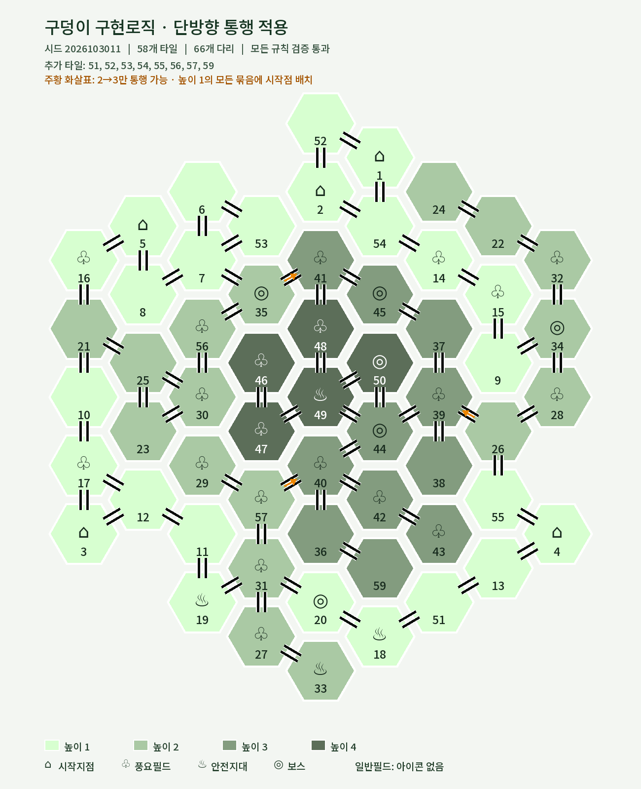
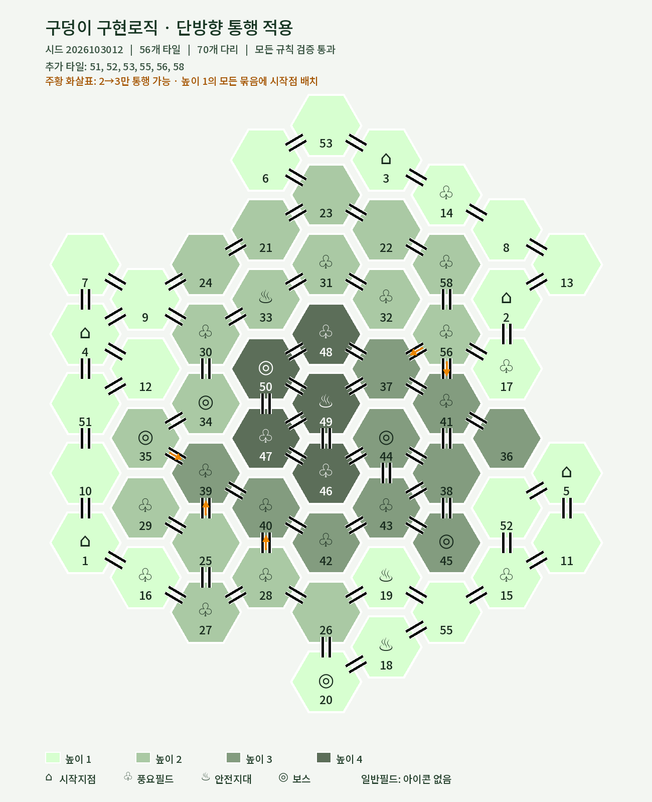
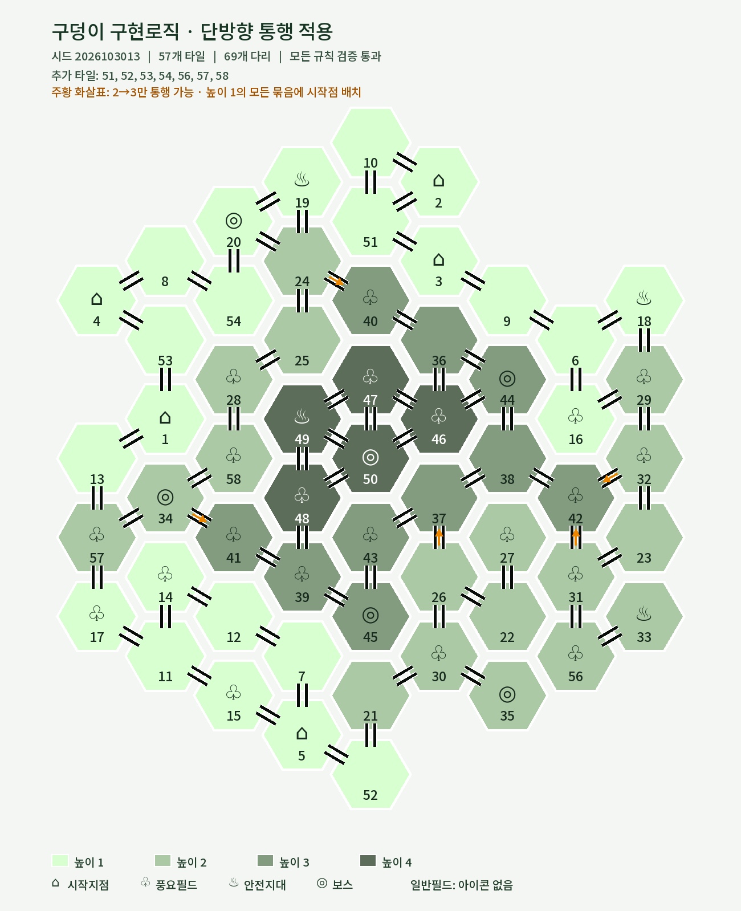
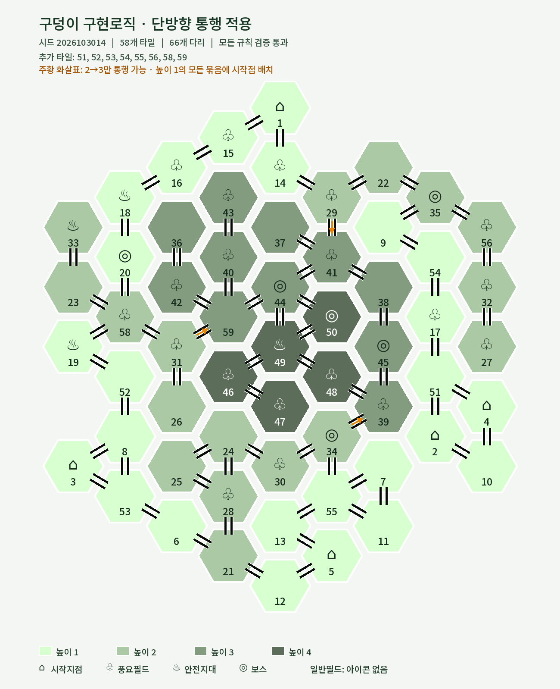
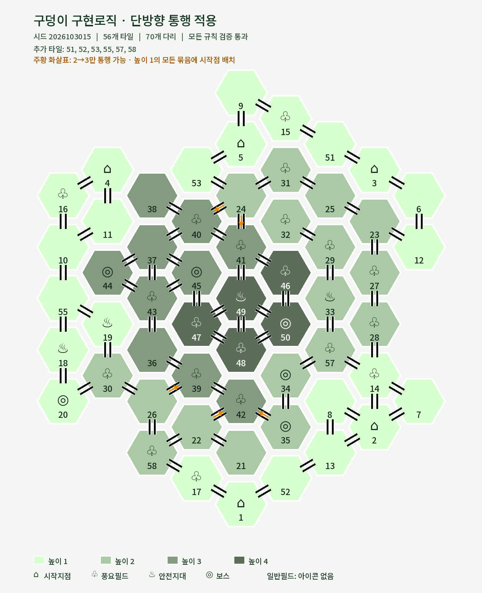
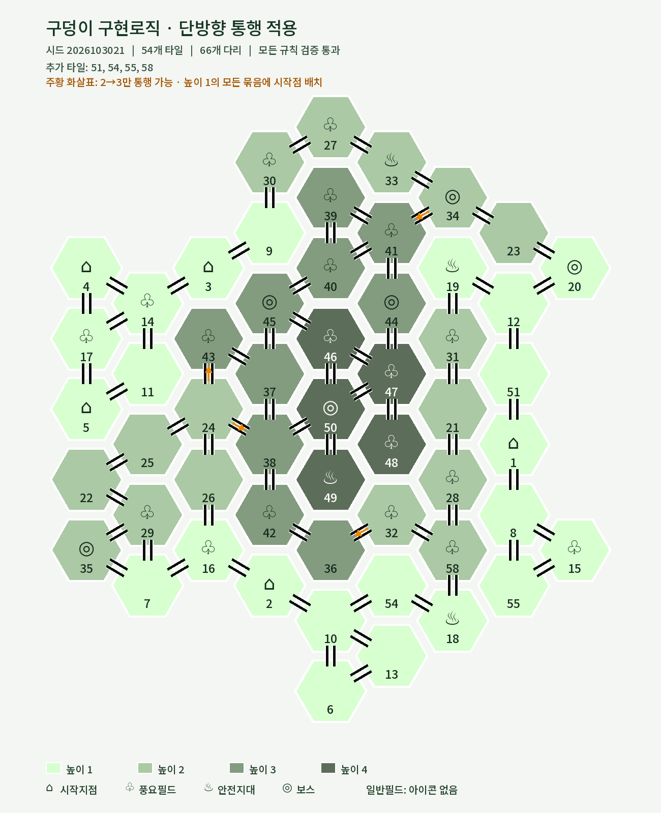
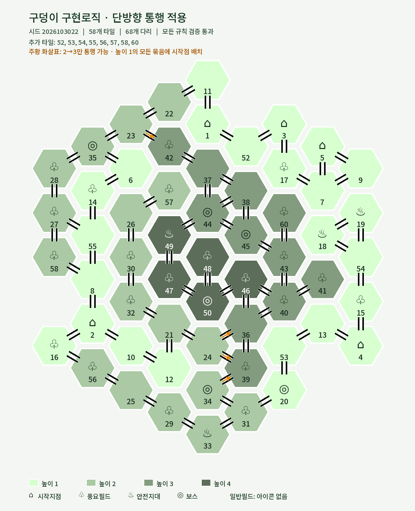
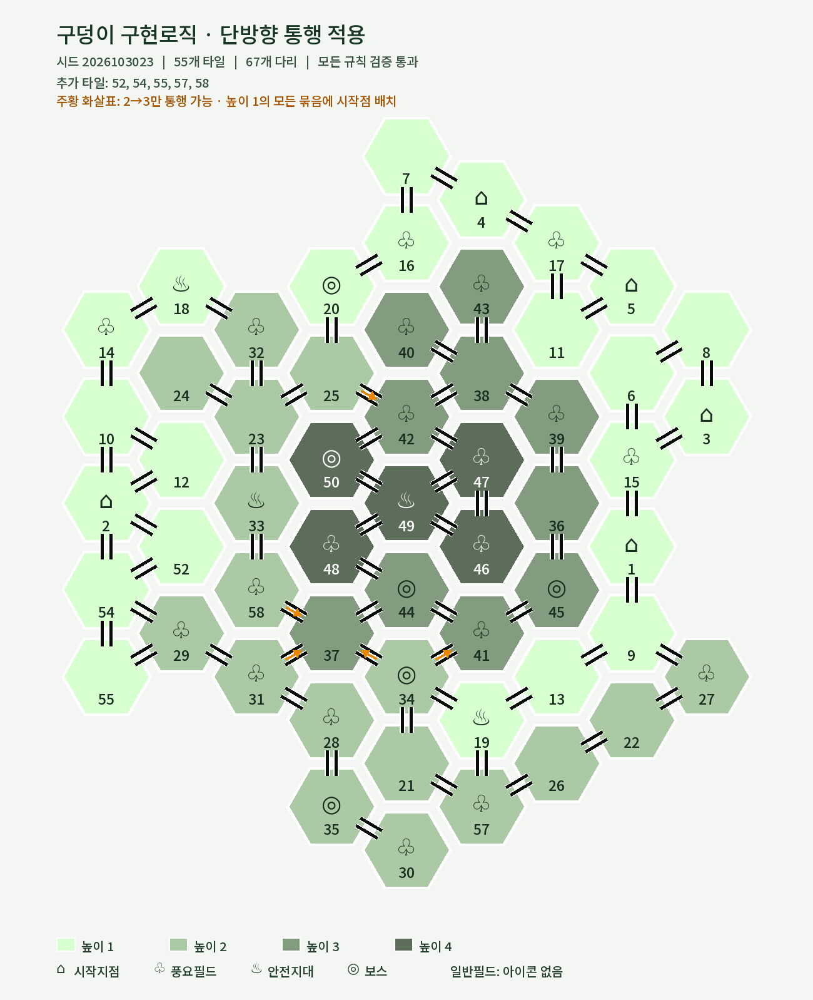
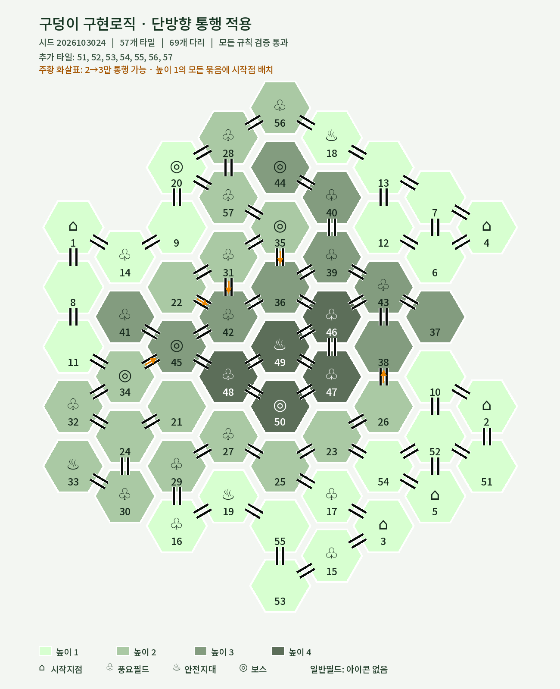
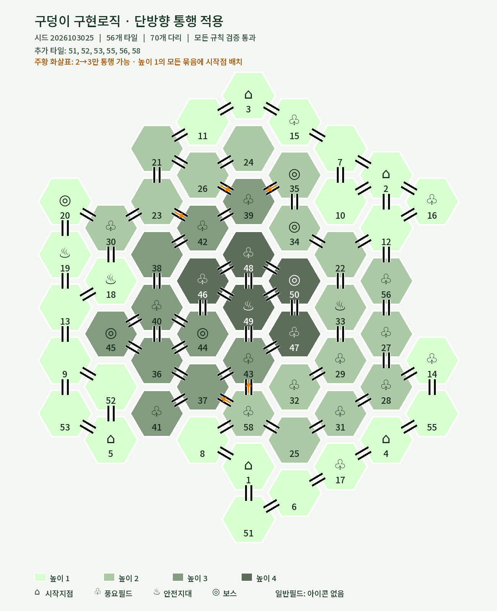

# 최신 규칙 지도 샘플

주황 화살표는 높이 2→3 허용 방향입니다. 높이 3→2는 통행할 수 없습니다. 각 높이 1 묶음에는 시작점이 하나 이상 있습니다. 모든 그림은 같은 이름의 시드 JSON에서 렌더링했습니다.

| 샘플 | 샘플 |
|---|---|
| [01번](pit_v4_map_01.png)  | [02번](pit_v4_map_02.png)  |
| [03번](pit_v4_map_03.png)  | [04번](pit_v4_map_04.png)  |
| [05번](pit_v4_map_05.png)  | [06번](pit_v4_map_06.png)  |
| [07번](pit_v4_map_07.png)  | [08번](pit_v4_map_08.png)  |
| [09번](pit_v4_map_09.png)  | [10번](pit_v4_map_10.png)  |

기준 샘플: [55개](map_20261030.png) · [60개](map_29.png) · [50개](map_56791.png)
